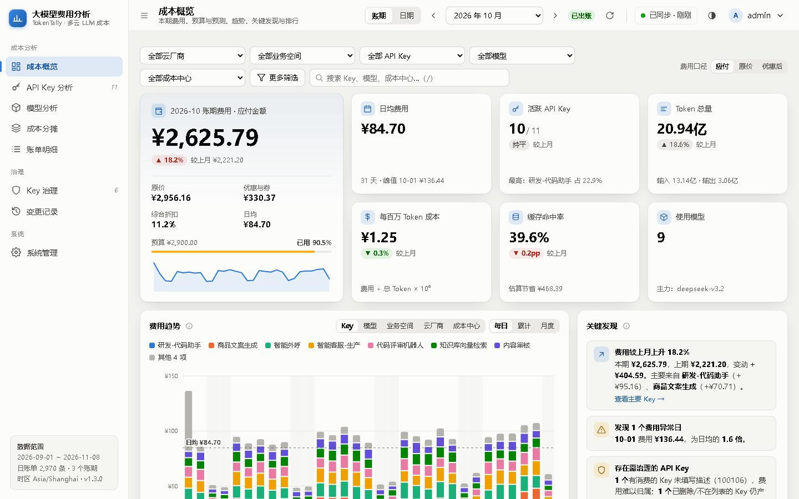
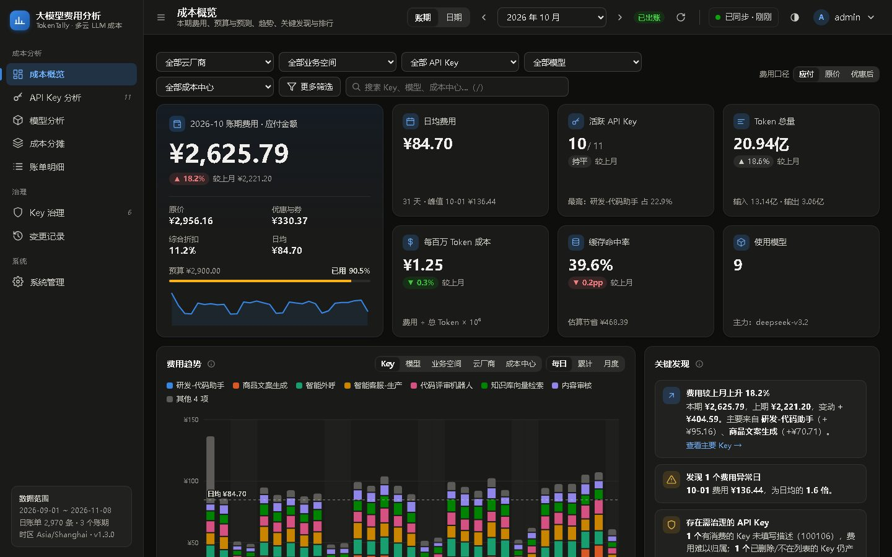
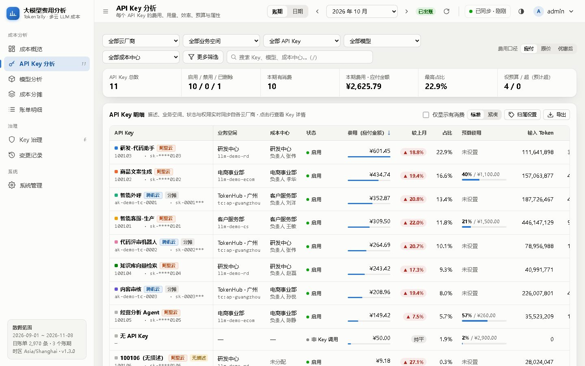
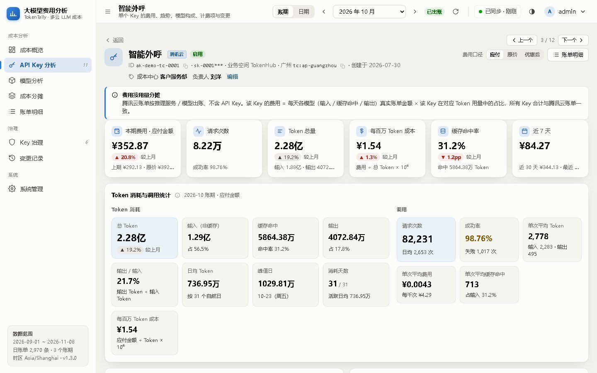
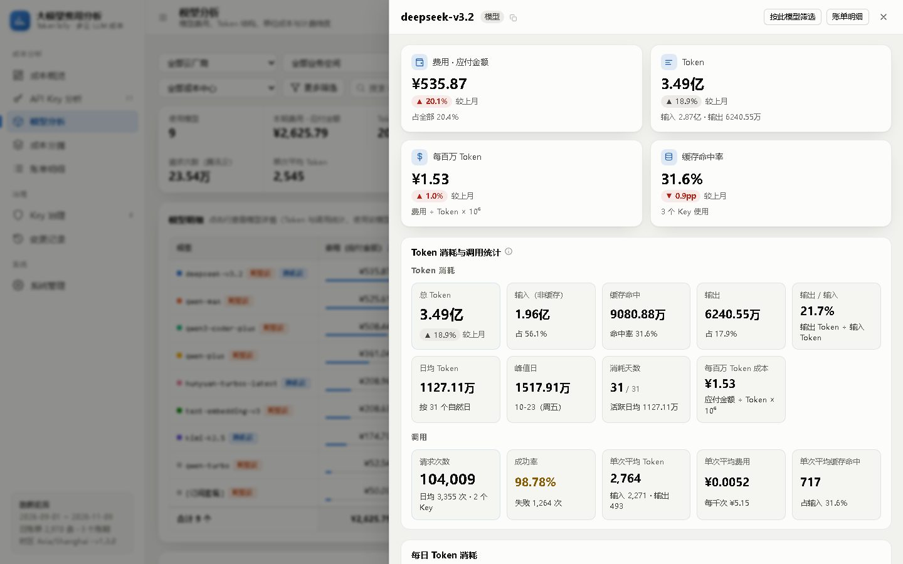
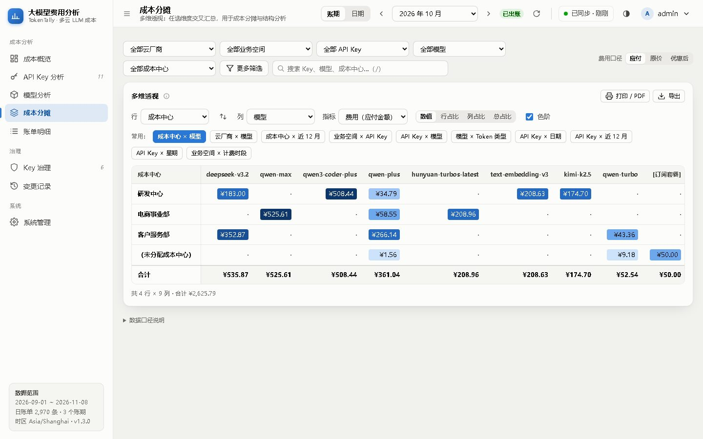
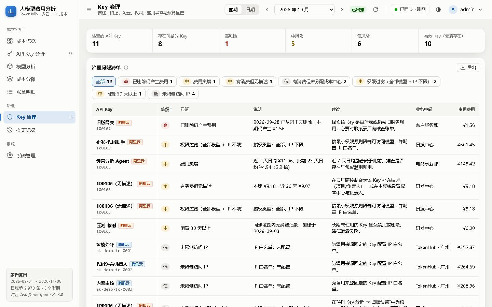
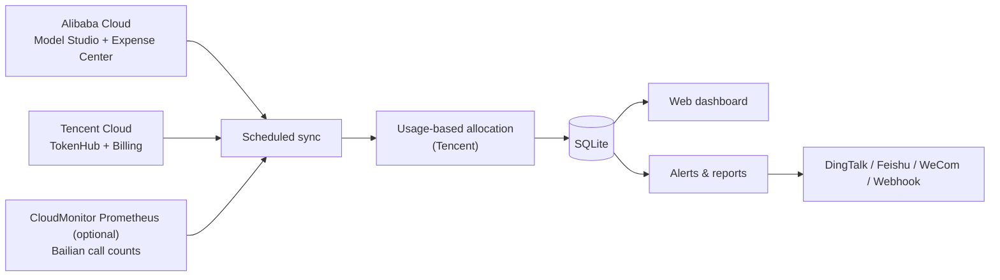

<div align="center">

# TokenTally

**Multi-cloud LLM API key cost management · Alibaba Cloud Model Studio (Bailian) + Tencent Cloud TokenHub**

How much does each API key, each model and each team really spend? See it on one page, deploy it with one command.

[](https://github.com/sreyun/tokentally/tags)
[](https://github.com/sreyun/tokentally/stargazers)


[简体中文](README.md) · English · [Deployment guide (zh)](docs/DEPLOYMENT.md) · [Changelog (zh)](CHANGELOG.md)



</div>

> The UI is in Simplified Chinese. Screenshots show randomly generated demo data.

## Why

LLM API keys multiply quickly — support, marketing, R&D and analytics teams each create their own, spread across clouds, accounts and workspaces. Cloud billing consoles bill by product or resource, so you can't easily answer:

- **Where did the money go?** Which key spent how much, on which models?
- **Who pays?** Costs can't be charged back to teams or projects.
- **Why the spike?** A leaked or misused key is discovered only at month end.
- **Will we overspend?** No per-key or per-department budgets, forecasts or alerts.
- **Key hygiene?** Keys without descriptions, with overly broad permissions, idle, or deleted-but-still-billing.

TokenTally syncs keys and bills (read-only) into a local SQLite database, analyses them by key / model / cost center / cloud, and pushes budget, anomaly and sync alerts to DingTalk, Feishu (Lark), WeCom or any webhook.

## Highlights

- **Bill-accurate per-key cost** — Alibaba Cloud instance bills map to keys directly. Tencent Cloud bills carry no key dimension, so TokenTally allocates the *real* bill amount by each key's token share per day / model / billing item; key totals match the bill exactly.
- **Multi-dimensional analysis** — key, model, workspace, cost center, owner, cloud, billing item, day, ISO week, weekday; free-form pivot with drill-down, CSV export and print / PDF.
- **Linked filters & drill-down** — pick a workspace and the key and model filters only list what belongs to it; conflicting filters are cleared automatically. A workspace → key → model drill tree, plus clickable legends, bar segments, heatmap cells, matrix cells and bill-detail cells. Filters and the period live in the URL, so views can be shared and the browser Back button undoes a drill-down step; alert and report links open the matching page and period.
- **Business analysis** — cost by workspace (or cost center / owner / cloud) with a detail page per workspace listing all of its keys, models, key × model matrix and trends.
- **Token & call statistics** — token structure, cache hit rate, unit cost, daily average and peak for every key and model, plus requests, success rate and average tokens / cost per request (Tencent TokenHub usage; Alibaba Cloud via the CloudMonitor Prometheus instance that Bailian monitoring exports to).
- **Budgets** — a monthly total budget plus monthly budgets per **cost center (department)** and per API key, all on payable amount. Cost-center spend is the month's bills grouped by each key's current cost-center tag; the unassigned bucket ("未分配成本中心") covers untagged keys and spend without a key and can have its own budget. Usage shows in business analysis (grouped by cost center), the cost-center detail page, key governance (over / forecast over budget) and the monthly report's cost-center ranking.
- **Alerts & reports** — up to 5 channels; budget, spend anomaly, sync failure, key changes, plus daily / weekly / monthly reports with @mentions and signed webhooks.

  | Alert | Fires when | Dedupe |
  |---|---|---|
  | Budget | Total, cost-center or key budget reaches the warning threshold or is exceeded; total budget forecast to be exceeded by month end | Once per threshold per cycle per channel |
  | Spend anomaly | Yesterday's list price ≥ 7-day average × ratio and the increase ≥ minimum amount (overall and per key) | Once per day |
  | Sync failure | Same sync type of a cloud fails 3 times in a row; recovery notice afterwards | Once per incident |
  | Key change | API key created / deleted / restored | Once per change |

  Channels can be scoped to workspaces or keys: a scoped channel gets budget alerts for keys in scope and for cost centers whose keys are all in scope (never the total budget). Saving settings never back-sends — new conditions alert on the next check.
- **Key governance** — automatic findings with severity and advice.
- **Security first** — AES-256-GCM encrypted credentials, read-only cloud permissions, password re-confirmation for sensitive actions, CSRF / CSP / rate limiting / audit log, SSRF-safe webhooks.
- **Zero dependencies** — only Node.js 24 built-ins (`node:http`, `node:sqlite`, `node:crypto`), no npm packages, no build step; `docker compose` deployment, automatic backups, Prometheus metrics, white-label branding.
- **Demo mode** — no cloud account needed: `DEMO_DATA=true`.

## Screenshots

| Overview (dark) | API keys |
|---|---|
|  |  |
| **Key detail: token & call statistics** | **Model detail** |
|  |  |
| **Cost allocation: cost center × model** | **Key governance** |
|  |  |

## Quick start

Try the demo (no cloud account required):

```bash
git clone https://github.com/sreyun/tokentally.git && cd tokentally && cp .env.example .env
```

```bash
sed -i "s|^APP_MASTER_KEY=.*|APP_MASTER_KEY=$(openssl rand -base64 32)|; s|^DEMO_DATA=.*|DEMO_DATA=true|" .env
```

```bash
docker compose up -d --build && docker compose logs app | grep 初始管理员密码
```

Open `http://localhost:8080` and sign in with the initial password from the log (the line is labelled `初始管理员密码`). For production, leave `DEMO_DATA=false`, then configure a read-only Alibaba Cloud RAM AccessKey and / or Tencent Cloud CAM API key under **系统管理 (Admin)**. Demo data is removed automatically once real credentials are saved.

## How it works



## Required permissions (read-only)

- **Alibaba Cloud RAM**: `AliyunBailianReadOnlyAccess` + `AliyunBSSReadOnlyAccess` (or the minimal custom policy in [README.md](README.md#-所需权限只读)).
- **Tencent Cloud CAM**: TokenHub read-only + billing read-only.

## FAQ

**Where do Alibaba Cloud request counts come from?** Neither the public Model Studio OpenAPI (all 38 operations of version 2026-02-10) nor the Expense Center bills return call counts — only tokens and amounts. Call counts live in the Bailian console's monitoring page and can be exported ("监控数据投递") to a CloudMonitor Prometheus instance. Since v1.4, TokenTally reads them from that instance: under **系统管理 → 阿里云接入 → 调用次数**, enter the Prometheus HTTP API address (and token), click "发现指标" to auto-detect the metric and labels, preview the last 7 days, then enable it. Average tokens per call use the bill tokens of the same day, key and model. Tencent TokenHub's usage API returns request counts directly.

## Roadmap

- [x] Alibaba Cloud Model Studio, Tencent Cloud TokenHub
- [x] Cost centers, budgets, alerts, reports, demo mode, backups, metrics
- [x] Alibaba Cloud call counts via CloudMonitor Prometheus
- [x] Business analysis, linked filters and multi-level drill-down
- [x] Email reports with the full cost overview, per-workspace / per-key channel scope, read-only share links
- [x] Cost-center (department) budgets and alerts
- [ ] More platforms (Volcengine Ark, Baidu Qianfan, …)
- [ ] Excel reports, SSO / LDAP

## Contributing

Issues and pull requests are welcome — new cloud providers, analysis dimensions, alert channels, docs and translations. Never include real credentials or billing data.

<div align="center">

**If TokenTally saves you time or money, please give it a ⭐ — it helps others find it.**

</div>
