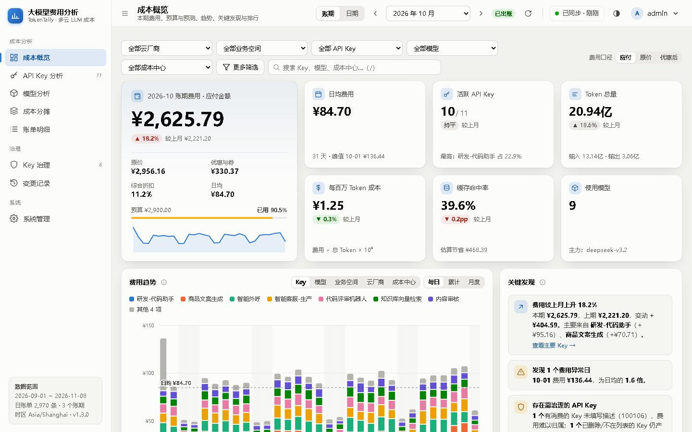
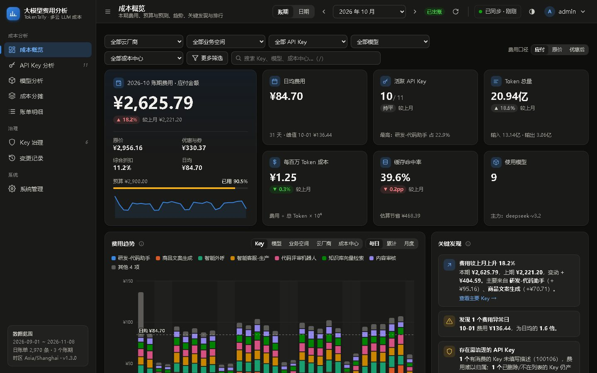
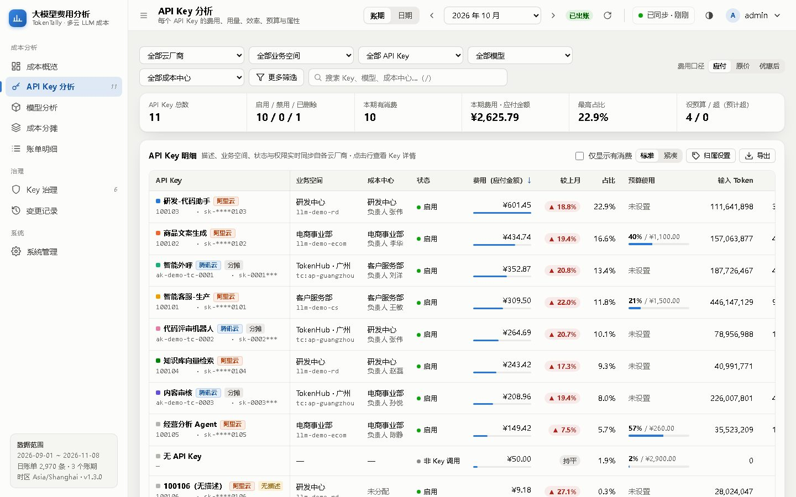
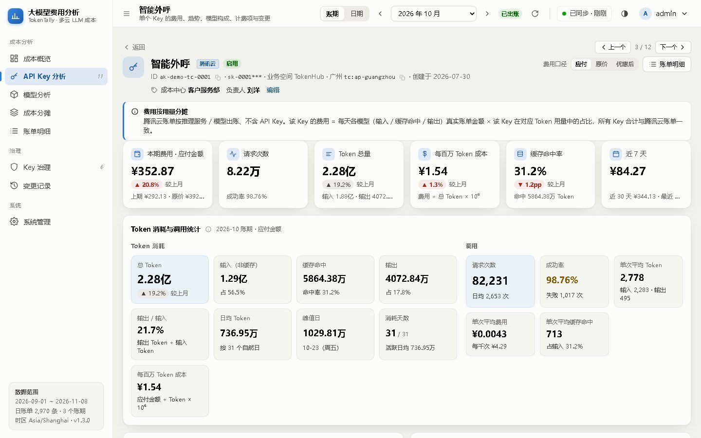
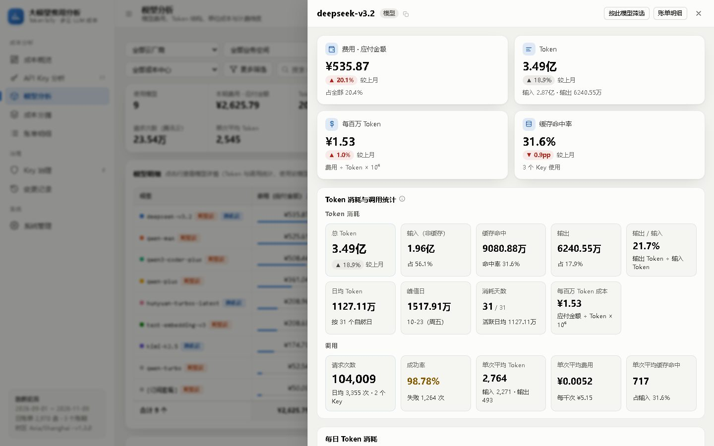
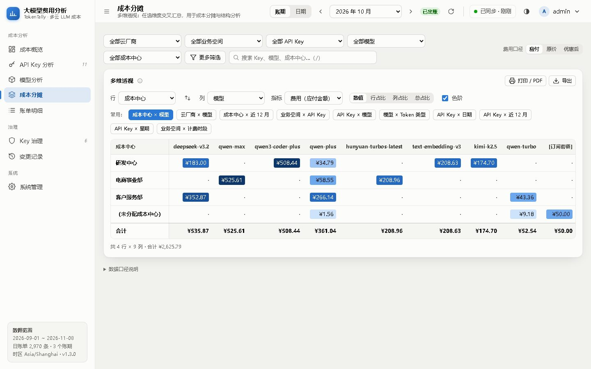
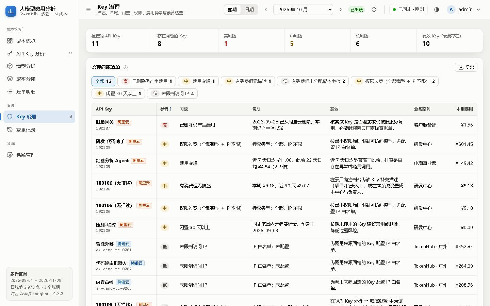
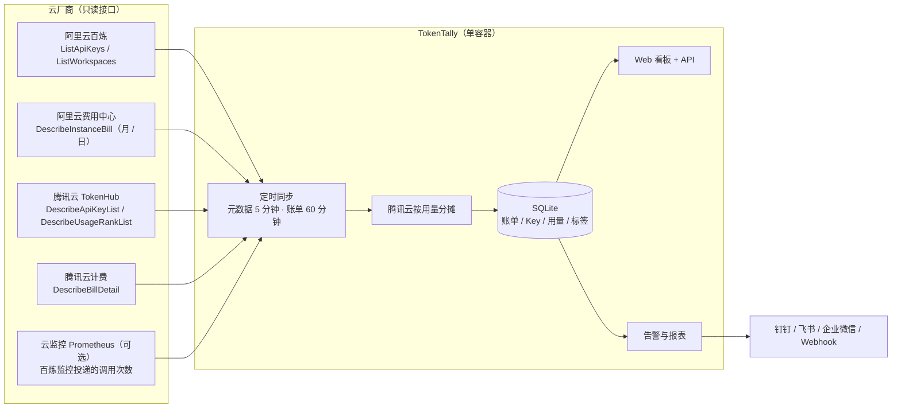

<div align="center">

# TokenTally

**多云大模型 API Key 成本管理平台 · 阿里云百炼 + 腾讯云 TokenHub**

每个 API Key、每个模型、每个部门到底花了多少钱？一个页面看清，一条命令部署。

[](https://github.com/sreyun/tokentally/tags)
[](https://github.com/sreyun/tokentally/stargazers)


简体中文 · [English](README.en.md) · [部署与运维手册](docs/DEPLOYMENT.md) · [更新日志](CHANGELOG.md)



</div>

---

## 为什么需要 TokenTally

公司里的大模型 API Key 越来越多：客服、营销、研发、数据分析各自申请，分布在阿里云、腾讯云多个账号和业务空间里。月底账单出来时，财务和负责人常常面对这些问题：

- 🔍 **花在哪了？** 云厂商费用中心按产品 / 资源出账，看不到“某个 Key 本月花了多少、用了哪些模型”
- 🏢 **算谁的？** 多个团队共用账号，成本无法按部门 / 项目分摊
- 💥 **为什么突然涨了？** 某个 Key 被泄露或误用，等到月底才发现
- ⏰ **会不会超支？** 没有按 Key 的预算与月末预测，告警全靠人盯
- 🧹 **Key 管不过来** 无描述、权限过宽、闲置、已删除仍在扣费的 Key 无人清理

**TokenTally 把这些问题变成一个自动更新的看板**：定时同步云厂商的 Key 与账单到本地 SQLite，按 Key / 模型 / 成本中心 / 云厂商多维分析，异常与超预算自动推送到钉钉、飞书、企业微信。

## ✨ 亮点

| | |
|---|---|
| 💰 **与账单一致的 Key 级费用** | 阿里云直接按实例账单归属到 Key；腾讯云账单不含 Key，按 TokenHub 用量占比**精确分摊真实账单**，合计与账单分毫不差 |
| 📊 **多维分析** | Key / 模型 / 业务空间 / 成本中心 / 负责人 / 云厂商 / 计费项 / 日 / 周 / 星期，任意交叉透视，一键导出与打印 |
| 🔗 **联动筛选与逐级下钻** | 选择业务空间，Key 与模型下拉只列出该空间关联的取值；业务空间 → Key → 模型层级钻取；图例、柱段、热力格、矩阵格、明细单元格都能点击下钻；筛选与周期写入地址，链接可分享、浏览器“后退”即撤销 |
| 🔢 **Token 与调用统计** | 每个 Key、每个模型的 Token 结构、缓存命中率、单位成本、日均与峰值；请求数、成功率、单次平均 Token / 费用（腾讯云 TokenHub 用量；阿里云接入百炼监控投递的云监控 Prometheus） |
| 🔔 **告警与报表推送** | 钉钉 / 飞书 / 企业微信 / Webhook / **邮件（附完整成本概览）**，最多 5 个渠道，可按业务空间或 API Key 限定推送范围（业务空间范围包含该空间下不属于任何 Key 的费用，与成本概览口径一致）：预算、费用异常、同步故障、Key 变更，以及含费用与 Token 用量的日报 / 周报 / 月报；消息可附带**免登录的只读交互报表链接**（飞书中在飞书内打开） |
| 🛡️ **Key 治理** | 自动发现已删除仍计费、权限过宽、无描述、闲置、费用突增、未分配成本中心等问题并给出建议 |
| 🔒 **安全优先** | 访问密钥 AES-256-GCM 加密、只读权限、敏感操作二次验证、CSRF / CSP / 限流 / 审计日志、Webhook 防 SSRF |
| 📦 **零依赖、易交付** | 纯 Node.js 24 内置模块，无 npm 依赖；`docker compose` 一键部署，自动备份、Prometheus 指标、品牌定制 |
| 🎮 **演示模式** | 没有云账号？`DEMO_DATA=true` 用虚构数据体验全部功能 |

## 📸 截图

| 成本概览（深色主题） | Key 分析 |
|---|---|
|  |  |
| **Key 详情：Token 消耗与调用统计** | **模型详情** |
|  |  |
| **成本分摊：成本中心 × 模型** | **Key 治理** |
|  |  |

> 截图均为演示模式下随机生成的虚构数据。

## 🚀 快速开始

### 1 分钟体验演示（无需云账号）

```bash
git clone https://github.com/sreyun/tokentally.git && cd tokentally && cp .env.example .env
```

```bash
sed -i "s|^APP_MASTER_KEY=.*|APP_MASTER_KEY=$(openssl rand -base64 32)|; s|^DEMO_DATA=.*|DEMO_DATA=true|" .env
```

```bash
docker compose up -d --build && docker compose logs app | grep 初始管理员密码
```

打开 `http://localhost:8080`，用日志中的初始密码登录即可看到两家云厂商的演示数据。配置真实访问密钥后，演示数据会自动清除。

### 正式部署

1. `cp .env.example .env`，填写 `APP_MASTER_KEY`（`openssl rand -base64 32` 生成，请单独保管）；需要消息附带交互报表链接、生成只读分享链接时同时填写 `PUBLIC_URL`（系统对外访问地址）
2. `docker compose up -d --build`
3. 用日志中的初始密码登录。管理员打开 **成本概览** 会看到 **初始设置清单**，每一步都有直达按钮，完成一步勾选一步，全部完成后自动隐藏（也可在本浏览器中关闭，用户菜单可重新打开）：
   1. 配置云厂商访问密钥：在 **系统管理** 中填写 **阿里云 RAM AccessKey** 和 / 或 **腾讯云 CAM API 密钥**（只读），点“测试”确认接口通过
   2. 首次账单同步：保存密钥后自动开始；如需全年历史，在 **数据同步** 中把回溯账期设为 12 并全量回溯
   3. 分配成本中心：**Key 分析 → 归属设置**（清单中可直接打开批量设置）
   4. 设置预算：**预算管理**
   5. 添加通知渠道：**告警通知** 中添加群机器人或邮件
   6. 设置 `PUBLIC_URL`（消息链接与分享）

需要 HTTPS、IP 白名单、备份恢复、Prometheus 监控？见 [部署与运维手册](docs/DEPLOYMENT.md)。

## 🧭 工作原理



**腾讯云 Key 级费用怎么来的？** 腾讯云账单按推理服务 / 模型出账、不含 API Key。TokenTally 同时拉取账单明细与 TokenHub 的“Key × 模型 × 日”用量：

> Key 费用 = 当日该模型同一计费项（输入 / 缓存命中 / 输出）的**真实账单金额** × 该 Key 在对应 Token 中的**占比**

最后一份取余数，所有 Key 合计与腾讯云账单完全一致；账单资源本身是 API Key 时直接归属。缺少计费权限时可按目录价估算（页面标注“估算”）。

## 🆚 与云厂商控制台对比

| 能力 | 云厂商控制台 | TokenTally |
|---|:---:|:---:|
| 按 API Key 的费用（与账单一致） | 部分（阿里云有汇总，腾讯云无） | ✅ 两家统一 |
| 多云 / 多账号统一视图 | ❌ | ✅ |
| 成本中心 / 部门分摊 | ❌ | ✅ |
| 按 Key 的预算与月末预测 | ❌ | ✅ |
| 预算 / 异常 / 同步故障推送到 IM | 有限 | ✅ 钉钉 · 飞书 · 企业微信 |
| 日报 / 周报 / 月报 | ❌ | ✅ |
| Key 治理检查 | ❌ | ✅ |
| 历史数据长期保存 | 受控制台保留期限制 | ✅ 本地 SQLite |
| 只读、可私有化部署 | — | ✅ |

## 📚 功能详解

<details>
<summary><b>成本分析</b>：概览、Key、模型、业务、透视、账单明细，以及联动与下钻</summary>

- **成本概览**：本期费用（应付 / 原价 / 优惠后）与环比、预算使用率与月末预测、每百万 Token 成本、缓存命中率；费用趋势（每日 / 累计对比 / 近 12 个账期，可按 Key、模型、业务空间、云厂商、成本中心分组）；关键发现（变化驱动、超预算、集中度、异常日、缓存节省、治理风险）；点击每日柱下钻到当日明细
- **Key 分析**：全部 Key 的云厂商、成本中心 / 负责人、状态、费用与环比、预算使用、Token、缓存命中率、单位成本、日均 Token、请求数 / 失败率 / 单次均 Token / 单次均费用、权限、IP 白名单；批量归属设置；消耗热力图
- **业务分析**：按业务空间（或成本中心 / 负责人 / 云厂商）汇总费用、关联 Key 数、Token、单位成本、请求数；每日趋势、费用构成、变动归因；**层级钻取** 业务空间 → Key → 模型；业务空间详情页列出该空间的全部 Key（含本期无消费的 Key）、模型排行、Key × 模型、关联维度、月度趋势与变更记录
- **Key 详情 / 模型详情**：Token 消耗与调用统计（总量与结构、输出 / 输入比、日均、峰值日、消耗天数、请求次数、成功率、单次平均）、每日 Token 结构图与调用次数图、模型 / Key 明细、计费项与单价、变更历史
- **成本分摊**：行 / 列任选云厂商、成本中心、负责人、业务空间、Key、模型、Token 类型、计费项、时段、渠道、日期、自然周、星期、近 12 月；数值 / 占比 / 色阶；单元格下钻；导出 CSV、打印 / PDF
- **账单明细**：逐条账单，标注“分摊 / 估算”口径，导出全部字段；Key / 业务空间 / 模型 / 日期单元格可直接下钻，计费项 / 渠道单元格一键追加筛选
- **联动与下钻**：筛选栏级联（选择业务空间后 Key、模型等下拉只列出关联取值，冲突的筛选自动清除并提示，显示当前范围摘要）；趋势图例按项筛选、柱段打开限定该项的当日明细；模型 / 当日明细抽屉可限定在某个 Key 或业务空间内；筛选与周期写入地址（如 `#/keys?cycle=2026-10&ws=…`），可收藏分享，告警与报表消息中的链接直达对应页面与周期
</details>

<details>
<summary><b>告警通知与报表</b></summary>

| 事件 | 触发条件 | 去重 |
|---|---|---|
| 预算告警 | 总预算 / Key 预算达到阈值、超出、预计月末超出 | 每阈值每账期每渠道一次 |
| 费用异常 | 昨日原价 ≥ 前 7 日原价日均 × 倍数且增量 ≥ 最小金额（整体与单个 Key；按原价判断，不受优惠集中抵扣影响） | 每天一次 |
| 同步故障 | 同一云厂商同类同步连续失败 3 次；恢复后通知 | 每次故障一次 |
| Key 变更 | 新增 / 删除 / 恢复 API Key | 每条一次 |
| 日报 / 周报 / 月报 | 每天设定时间；周一发周报；次月出账后发月报（含成本中心分摊）；新订阅从下一个周期开始 | 每周期一次 |

支持 @ 手机号 / @所有人、钉钉与飞书加签、通用 Webhook HMAC 签名；渠道失败互不影响并自动重试；报表可预览与立即发送（按所选渠道的推送范围生成，限定范围的渠道在测试消息、预览与立即发送中同样只看到范围内的数据）。Webhook 仅 HTTPS、官方域名白名单、连接阶段拦截内网地址。

**保存配置只保存、不推送**：新增 / 重新启用渠道、新勾选事件、修改推送范围时，当前已到点的报表（今天的日报、上周的周报、已出账的上月月报）与已满足的告警条件不补发；之后日报每天、周报每周一在设定时间发送，月报在上月出账后发送，告警在出现新的条件时发送。把报表时间改到今天已过的时刻，今天的日报也不会在保存后补发。渠道卡片显示每类报表的下次发送时间。

**飞书消息卡片**：标题栏（主题色 + 副标题 + 状态标签，如“较前一日 ↑ 6.2%”“2 项异常”“已超支”）、灰底指标面板（昨日费用与涨跌、本月累计与月末预测、预算使用率）、近 14 日每日费用柱状图（飞书 7.1+ 的图表组件，可悬停查看金额、点击全屏）、对齐的 API Key / 模型排行表、带彩色标签的告警条目，以及“查看详情 / 成本概览”按钮。机器人不接受图表或新版卡片组件（或“自定义关键词”只出现在原写法中）时自动改发不含图表的卡片或原来的简洁卡片，内容一定送达；“测试”与“立即发送”会提示实际使用的样式。钉钉、企业微信、邮件与通用 Webhook 为文本消息，内容相同。

**Token 用量**：日报 / 周报 / 月报除费用外，还推送 Token 用量——昨日（上周 / 账期）Token 与涨跌、本月累计 Token、日均 Token、单位成本（每百万 Token 应付金额）、每日 Token 趋势，以及 **Token 用量 API Key Top 5 与模型 Top 3**（按 Token 排序，含占比）；限定推送范围的渠道只统计范围内的 Key；账单不含 Token 用量时（如只用按次 / 按张计费的模型）不显示用量部分。

**只读分享链接（交互报表）**：渠道勾选“附带只读交互报表链接”后（需设置 `PUBLIC_URL`），每条报表 / 告警消息附带一个免登录链接，打开即为该渠道范围、对应周期（日报为昨日所在账期、周报为上周、月报为上月、告警为本月）的交互式成本概览：可悬停查看明细、在成本概览 / Key 分析 / 模型分析 / 业务分析 / 成本分摊 / 账单明细之间切换、筛选与下钻，但不能修改任何配置。飞书中“查看交互报表”按钮通过 AppLink 在飞书内打开（PC 为飞书独立窗口，移动端为飞书内置浏览器），邮件中为“在浏览器中查看交互报表”按钮。管理员也可以在“告警通知 → 只读分享链接”中按账期手动生成链接。

- 令牌 32 字节随机数，只出现在链接的 `#` 片段中（不会发送给服务器、不进入代理访问日志与 Referer），系统只保存其 SHA-256
- 打开时用令牌换取 HttpOnly + SameSite=Strict 的分享会话（最长 12 小时），只能读取该链接限定周期与范围的数据，不能访问任何其他接口；限定范围时不显示总预算
- 有效期 1～90 天（默认 7 天），可逐个或一键撤销，撤销后已打开的页面也立即失效；无效令牌按 IP 限流
- 访问次数、最近访问 IP 与归属地显示在链接列表中，每次打开记入操作日志（用户为“分享链接”）

**邮件通知**：在“告警通知 → 邮件服务器（SMTP）”配置发信服务器（SSL / TLS 或 STARTTLS，密码或授权码加密保存；修改密码或服务器地址需当前登录密码确认），再添加“邮件”渠道填写收件人。每封邮件在消息内容之后附上**完整的成本概览**（本期费用与原价 / 折扣 / 优惠券分项、预算与预测、6 项指标、每日费用与 Token 趋势、API Key 与模型排行、费用构成、变动归因、Key 治理（与“Key 治理”页面规则一致）、关键发现），日报为昨日所在账期、周报为上周、月报为上月、告警为本月。收件人中有地址被邮件服务器拒绝（如拼写错误、邮箱不存在）时，其余收件人照常收到，“测试”“立即发送”与渠道卡片会提示被拒绝的地址。

**推送范围**：每个渠道可限定为指定业务空间或 API Key（如把某个项目的日报只发给该项目负责人）：成本概览与报表摘要只统计范围内的数据，预算告警只推送范围内 Key 的预算，费用异常检查范围合计与范围内的 Key，Key 变更只推送范围内的 Key；同步故障为系统事件，不受范围限制。
</details>

<details>
<summary><b>Key 治理</b></summary>

已删除 / 已禁用仍计费、超出 / 预计超出预算、费用突增、有消费无描述、未分配成本中心、权限过宽（全部模型 + IP 不限）、闲置 30 天、未限制 IP、未归属业务空间，分高 / 中 / 低三级并给出处置建议。
</details>

<details>
<summary><b>安全</b></summary>

| 层面 | 措施 |
|---|---|
| 凭证 | 访问密钥、Webhook 地址与密钥 AES-256-GCM 加密存储，只写不回显；主密钥来自环境变量，与数据卷分离 |
| 签名 | 阿里云 ACS3、腾讯云 TC3 签名启动时用官方示例自检；后端只开放只读接口白名单 |
| 账号 | scrypt 密码哈希、强密码策略、首次登录强制改密、登录失败锁定、统一错误提示防枚举 |
| 会话 | HttpOnly + SameSite=Strict（HTTPS 下 `__Host-` + Secure），空闲 / 最长超时；后台轮询不续期会话 |
| 敏感操作 | 更换访问密钥、下载备份须再次输入密码，连续输错强制退出全部会话并审计 |
| 请求 | CSRF 令牌 + Origin 校验、严格 CSP、HSTS、请求体与频率限制、可选 IP 白名单 |
| 外发 | Webhook 防 SSRF（官方域名白名单 + 连接阶段拦截内网 / DNS 重绑定）、超时与响应大小限制 |
| 容器 | 非 root、只读根文件系统、`cap_drop: ALL`、`no-new-privileges`、资源限制、健康检查 |
</details>

<details>
<summary><b>运维与交付</b></summary>

- 自动一致性备份（每天，保留 N 份）、管理页立即备份与验证下载
- `/healthz`、`/readyz`、Prometheus `/metrics`（Bearer 令牌）
- 品牌定制（产品名称 / 副标题 / 界面主题色）、管理员 / 只读两种角色、审计日志（中文说明 + IP 归属地）
- 用户操作日志：所有用户（含只读用户）的登录、页面访问（含统计周期与筛选）、数据查询、导出 / 下载、配置变更、权限拒绝，记录 IP 与归属地、设备、结果与耗时；按用户 / 分类 / 结果 / 日期 / 关键字筛选，用户活跃统计，可导出；不记录任何密码与密钥
- IP 归属地使用内置 ip2region 离线库，只在本机查询，不把客户端 IP 发给任何第三方
- 升级：`git pull && docker compose up -d --build`，数据库自动迁移
</details>

## 🔑 所需权限（只读）

**阿里云 RAM**：`AliyunBailianReadOnlyAccess` + `AliyunBSSReadOnlyAccess`，或最小权限：

```json
{
  "Version": "1",
  "Statement": [
    { "Effect": "Allow", "Action": ["modelstudio:ListWorkspaces", "modelstudio:ListApiKeys", "modelstudio:GetApiKey", "modelstudio:GetBillingOverview", "modelstudio:GetBillingTrend"], "Resource": "*" },
    { "Effect": "Allow", "Action": ["bss:DescribeInstanceBill", "bss:QueryBillOverview"], "Resource": "*" }
  ]
}
```

**腾讯云 CAM**：TokenHub 只读 + 费用中心账单只读，或参考（以 CAM 控制台策略语法为准）：

```json
{
  "version": "2.0",
  "statement": [
    { "effect": "allow", "action": ["tokenhub:DescribeApiKeyList", "tokenhub:DescribeModelEndpointList", "tokenhub:DescribeUsageRankList", "tokenhub:DescribeModelList"], "resource": ["*"] },
    { "effect": "allow", "action": ["finance:DescribeBillDetail", "finance:DescribeBillSummaryByProduct"], "resource": ["*"] }
  ]
}
```

## ⚙️ 配置

<details>
<summary>环境变量</summary>

| 变量 | 默认 | 说明 |
|---|---|---|
| `APP_MASTER_KEY` | — | 加密主密钥，**必填**，≥32 字符 |
| `ADMIN_USERNAME` / `ADMIN_PASSWORD` | admin / 随机 | 仅在没有任何用户时创建 |
| `HTTP_PORT` / `BIND_ADDR` | 8080 / 0.0.0.0 | 对外端口与绑定地址 |
| `TRUST_PROXY` / `COOKIE_SECURE` | false / auto | 反向代理（true 或可信代理层数，客户端 IP 取 X-Forwarded-For 右起第 N 个；也可在“安全与审计 → 客户端 IP 识别”中设置，页面设置优先）与 Cookie Secure |
| `DOMAIN` | — | `https` profile（Caddy 自动证书）使用的域名 |
| `ALLOW_CIDRS` | — | IP 白名单（健康检查不受限；格式错误时拒绝启动） |
| `RATE_LIMIT_PER_MIN` | 600 | 每个 IP 每分钟的接口请求上限（静态资源不计入） |
| `TRUSTED_PROXIES` | 本机 / 内网 / 100.64.0.0/10 | 只信任来自这些地址的 X-Forwarded-* 头（配合 `TRUST_PROXY`） |
| `SESSION_IDLE_MINUTES` / `SESSION_MAX_HOURS` | 120 / 12 | 会话超时 |
| `LOGIN_MAX_FAILURES` / `LOGIN_LOCK_MINUTES` / `LOGIN_MAX_PER_IP` | 5 / 15 / 20 | 登录防暴力破解 |
| `BILL_TZ` | Asia/Shanghai | 账单自然日时区：须与阿里云出账时区一致（中国站为北京时间，一般不要修改；无效时区拒绝启动；腾讯云固定按北京时间） |
| `MAX_DATA_LINES` | 100000 | 日期范围查询返回的按日账单行上限（本期 + 对比期） |
| `SYSTEM_LOG_DAYS` | 30 | 系统日志保留天数（系统管理 → 系统日志） |
| `OPLOG_DAYS` | 180 | 用户操作日志保留天数（系统管理 → 操作日志，最多 100 万条） |
| `IP_REGION_DB` / `IP_REGION_DB_V6` | 内置 IPv4 库 | IP 归属地离线库（ip2region xdb）路径；也可直接把 `ip2region_v4.xdb` / `ip2region_v6.xdb` 放到数据目录 |
| `ALIBABA_CLOUD_ACCESS_KEY_ID` / `_SECRET` | — | 可选：首次启动导入阿里云密钥后加密存库 |
| `TENCENTCLOUD_SECRET_ID` / `_KEY` | — | 可选：首次启动导入腾讯云密钥后加密存库 |
| `PUBLIC_URL` | — | 系统对外访问地址：告警消息中的跳转链接与只读分享链接（未设置时消息不附带链接、不能生成分享链接） |
| `ALERT_ALLOW_PRIVATE` | false | 允许通用 Webhook / SMTP 服务器指向内网（内网邮件中继） |
| `BACKUP_KEEP` / `BACKUP_HOUR` | 7 / 3 | 自动备份份数（0 关闭）与时间 |
| `METRICS_TOKEN` | — | ≥16 位，开启 `/metrics` |
| `DEMO_DATA` | false | 演示模式 |
| `TENCENT_ENDPOINT_OVERRIDE` | — | 仅测试 / 私有网关 |
</details>

## ❓ 常见问题

<details>
<summary><b>阿里云 Key 的调用次数从哪里来？</b></summary>

阿里云百炼的公开 OpenAPI（ModelStudio 2026-02-10 全部 38 个接口）和费用中心账单都只返回 Token 用量与金额，不含调用次数。调用次数在百炼控制台“监控告警”中按模型 / API Key 提供，并可通过“监控数据投递”写入云监控 Prometheus 实例。TokenTally 支持对接该实例（v1.4 起）：

1. 百炼控制台 → 监控告警 → 开启**监控数据投递**，选择云监控 Prometheus 实例
2. 在 Prometheus 实例的“设置”页复制 **HTTP API 地址**（及鉴权 Token）
3. 系统管理 → 阿里云接入 → **调用次数**：填写地址后点“发现指标”自动识别指标与标签，“预览近 7 天”核对无误后启用

之后调用次数随账单同步更新；单次平均 Token 取同日同 Key 同模型的账单 Token，与费用口径一致。调用次数从开启投递之日起才有数据。腾讯云 TokenHub 的用量统计接口直接提供请求数，无需额外配置。
</details>

<details>
<summary><b>按账期和按日期查询同一个月，金额不一样？</b></summary>

先看筛选栏右侧的**费用口径**：它保存在浏览器中并用于所有页面。“应付金额”（默认）= 原价 − 折扣 − 优惠券 / 代金券抵扣，与费用中心账单一致；“优惠后金额”= 原价 − 折扣，**未扣除优惠券**，有优惠券抵扣时会更高（如 10 月：优惠后 ¥4,190.20，应付 ¥3,674.55，差额正是优惠券抵扣 ¥515.65）。非“应付”口径时，筛选栏下方会显示提示，点 × 即可恢复。

同一口径下，整月按账期（月账单）与按日期（日账单）的原价、折扣、优惠券与应付金额完全一致。但优惠券与折扣按云厂商实际抵扣的日期计入（优惠券会从某天起连续抵扣直到用完，当天应付可能为 0），只查询月内部分日期时金额不会按天均摊；费用趋势的提示中会显示每天的原价与优惠。
</details>

<details>
<summary><b>数据和阿里云 / 腾讯云控制台对不上？</b></summary>

“账期”口径使用月度账单、“日期”口径使用按天账单；账单相对调用延迟数小时，当月数据持续更新，次月 3 日后出账为准。应付金额 = 原价 − 优惠 − 优惠券抵扣（税前），可在页面切换为原价或优惠后金额。
</details>

<details>
<summary><b>需要什么权限？会修改云上的东西吗？</b></summary>

只需要只读权限，后端只调用只读接口白名单中的接口；成本中心、预算等都是本地数据，不会写回云厂商。
</details>

<details>
<summary><b>能支持更多云厂商吗？</b></summary>

可以，同步层按云厂商解耦（见 `app/src/aliyun.mjs`、`app/src/tencent.mjs`）。欢迎在 Issue 中告诉我们你最需要的平台。
</details>

## 🗺️ 路线图

- [x] 阿里云百炼：Key / 业务空间 / 账期与按日账单
- [x] 腾讯云 TokenHub：Key / 用量 / 账单按用量分摊
- [x] 成本中心、预算、告警推送、日 / 周 / 月报
- [x] 演示模式、自动备份、Prometheus 指标、品牌定制
- [x] 阿里云调用次数（接入百炼监控投递的云监控 Prometheus）
- [x] 业务分析、联动筛选与多维逐级下钻
- [x] 邮件报表（附完整成本概览）、按业务空间 / API Key 限定推送范围、免登录只读交互报表链接
- [ ] 火山引擎方舟、百度千帆等更多平台
- [ ] 成本中心（部门）预算与告警
- [ ] Excel 报表
- [ ] SSO / LDAP 登录

## 🧱 技术栈与目录

纯 **Node.js 24** 内置模块（`node:http`、`node:sqlite`、`node:crypto`），前端为原生 ES 模块 + 手写 SVG 图表，**无任何 npm 依赖、无构建步骤、无外部 CDN**。

```
app/src      server（HTTP / 鉴权 / 路由）· sync（多云同步）· aliyun · tencent · alerts · db · demo · crypto · config · iploc（IP 归属地）· smtp（邮件发送）· overview-mail（成本概览邮件）
app/public   index.html · login.html · boot.js · app.css · js/（main · core · charts · table · stats · insights · labels · views/）
app/geo      ip2region_v4.xdb（IP 归属地离线库，Apache-2.0 / MIT，见 app/geo/NOTICE）
docs/        DEPLOYMENT.md · images/
```

不用 Docker 也能运行（Node.js ≥ 22.16，需要 node:sqlite 的在线备份接口）：

```bash
cd app && DATA_DIR=./data DEMO_DATA=true node --disable-warning=ExperimentalWarning src/server.mjs
```

未设置 `APP_MASTER_KEY` 时主密钥自动生成并保存在 `DATA_DIR/.master.key`。生产环境请用 `openssl rand -base64 32` **生成一次**后固定写入环境变量（不要每次启动重新生成，否则已保存的访问密钥与告警地址都无法解密）。

## 🤝 参与贡献

欢迎提交 Issue 与 Pull Request：新的云厂商接入、分析维度、告警渠道、文档与翻译都非常欢迎。提交前请确保不包含任何真实密钥或账单数据。

---

<div align="center">

**如果 TokenTally 帮你省下了时间或成本，请点一个 ⭐ Star，让更多人看到它。**

[](https://star-history.com/#sreyun/tokentally&Date)

</div>
